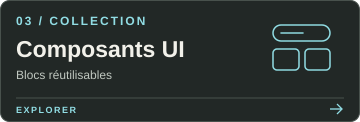

  <strong>Une bibliothèque visuelle pour concevoir de meilleures interfaces.</strong> 
  Des ressources sélectionnées, documentées et prêtes à retrouver.

  <a href="#collections">Collections</a> ·
  <a href="#galerie">Galerie</a> ·
  <a href="CONTRIBUTING.md">Ajouter une ressource</a>

---

## Collections

<table>
<tr>
<td width="50%"></td>
<td width="50%"></td>
</tr>
<tr>
<td width="50%"></td>
<td width="50%"></td>
</tr>
<tr>
<td width="50%"></td>
<td width="50%"></td>
</tr>
<tr>
<td width="50%"></td>
<td width="50%"></td>
</tr>
</table>

## Galerie

Un aperçu pour chaque ressource, une fiche dédiée et les fichiers associés lorsque leur licence le permet.

<!-- gallery:start -->
*La collection prend forme. Les premières ressources apparaîtront ici.*
<!-- gallery:end -->

## L'esprit de la collection

Observer ce qui fonctionne. Comprendre les choix de design. Retrouver les bonnes références au moment de concevoir.

Chaque entrée conserve sa source, ses droits d'utilisation, son contexte et ce qui mérite d'être retenu : lisibilité, composition, hiérarchie, interactions, couleurs ou mouvement. Les références et les ressources réellement réutilisables sont distinguées.

Les visuels de navigation sont intégrés au dépôt, sans service externe. Le catalogue est construit à partir des fiches de ressources avec une commande locale, sans dépendance ni GitHub Actions.

---

NEOSODA &nbsp; / &nbsp; DESIGN ARCHIVE &nbsp; / &nbsp; 2026

