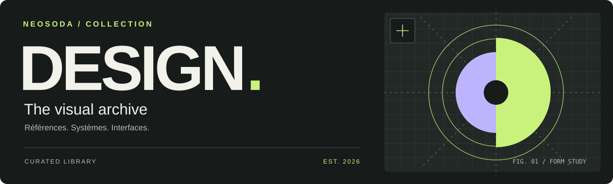
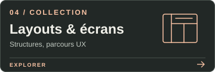
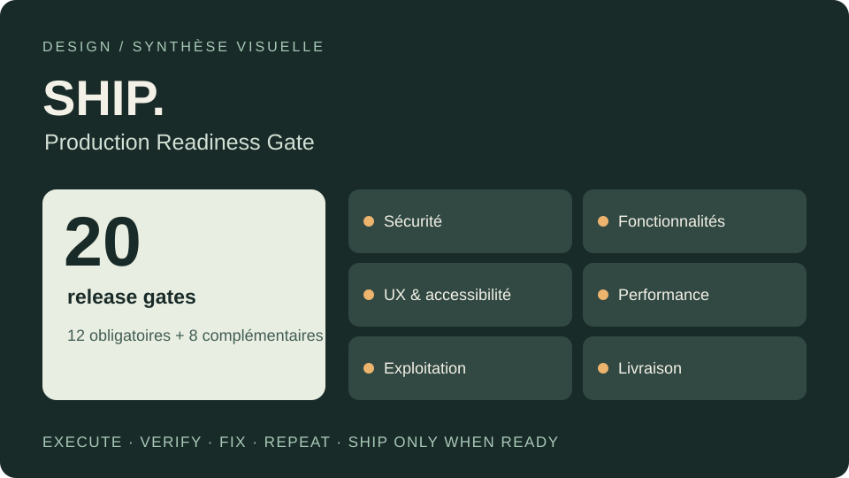

  <strong>Une bibliothèque visuelle pour concevoir de meilleures interfaces.</strong> 
  Des ressources sélectionnées, documentées et prêtes à retrouver.

  <a href="#collections">Collections</a> ·
  <a href="#galerie">Galerie</a> ·
  <a href="CONTRIBUTING.md">Ajouter une ressource</a>

---

## Collections

<table>
<tr>
<td width="50%"></td>
<td width="50%"></td>
</tr>
<tr>
<td width="50%"></td>
<td width="50%"></td>
</tr>
<tr>
<td width="50%"></td>
<td width="50%"></td>
</tr>
<tr>
<td width="50%"></td>
<td width="50%"></td>
</tr>
</table>

## Galerie

Un aperçu pour chaque ressource, une fiche dédiée et les fichiers associés lorsque leur licence le permet.

<!-- gallery:start -->
<table>
<tr>
<td width="50%" valign="top"><a href="collections/themes/admin-dashboard-v15/README.md"> <strong>Admin Dashboard V15</strong></a> Dashboard React responsive avec KPI, tableaux, graphiques et paramètres personnalisables. Réutilisable · react · dashboard · typescript</td>
<td width="50%" valign="top"><a href="collections/design-systems/radar-cap/README.md"> <strong>RADAR · Cap</strong></a> Identité éditoriale : cible ouverte, point corail, typographie Schibsted Grotesk et ton professionnel. Référence · branding · logo · editorial · radar</td>
</tr>
<tr>
<td width="50%" valign="top"><a href="collections/design-systems/rapport/README.md"> <strong>Rapport · CRM</strong></a> Charte UX/UI éditoriale : toile pêche-sauge, cartes métier colorées, transitions et surfaces givrées. Référence · crm · motion · tokens · prototype</td>
<td width="50%" valign="top"><a href="collections/design-systems/sentinelflow/README.md"> <strong>SentinelFlow · Identité V1</strong></a> Référentiel ITSM : identité de marque, tokens, composants, contrastes et écrans métier. Référence · itsm · tokens · design-system · accessibility</td>
</tr>
<tr>
<td width="50%" valign="top"><a href="collections/design-systems/warm-frosted-editorial/README.md"> <strong>Warm Frosted Editorial</strong></a> Charte Bento lumineuse : verre dépoli chaud, sable, sauge, sapin et corail. Référence · bento · glassmorphism · tokens · editorial</td>
<td width="50%" valign="top"><a href="collections/components/glassy-otp/README.md"> <strong>Glassy OTP</strong></a> Composant OTP animé en verre fumé, saisie à quatre chiffres et validation lumineuse. Référence · react · otp · motion · glassmorphism</td>
</tr>
<tr>
<td width="50%" valign="top"><a href="collections/assets/loup-cyberpunk/README.md"> <strong>Loup cyberpunk</strong></a> Illustration de loup cyberpunk, atmosphère Matrix et code vert. Référence · avatar · cyberpunk · illustration · matrix</td>
<td width="50%" valign="top"><a href="collections/inspiration/loop-engineering/README.md"> <strong>Loop Engineering · Product Engineering V2</strong></a> Méthode d&#x27;ingénierie itérative, qualité produit et contrôle UX/UI anti-slop. Référence · prompt · workflow · ux · quality</td>
</tr>
<tr>
<td width="50%" valign="top"><a href="collections/inspiration/ship-production-readiness/README.md"> <strong>SHIP · Production Readiness Gate</strong></a> Master prompt de validation finale : 20 release gates, corrections itératives et décision de livraison fondée sur des preuves. Référence · prompt · release · security · qa · ux</td>
<td width="50%"></td>
</tr>
</table>
<!-- gallery:end -->

## L'esprit de la collection

Observer ce qui fonctionne. Comprendre les choix de design. Retrouver les bonnes références au moment de concevoir.

Chaque entrée conserve sa source, ses droits d'utilisation, son contexte et ce qui mérite d'être retenu : lisibilité, composition, hiérarchie, interactions, couleurs ou mouvement. Les références et les ressources réellement réutilisables sont distinguées.

Les visuels de navigation sont intégrés au dépôt, sans service externe. Le catalogue est construit à partir des fiches de ressources avec une commande locale, sans dépendance ni GitHub Actions.

---

NEOSODA &nbsp; / &nbsp; DESIGN ARCHIVE &nbsp; / &nbsp; 2026

