

  <strong>Une bibliothèque visuelle pour concevoir de meilleures interfaces.</strong> 
  Des ressources sélectionnées, documentées et prêtes à retrouver.

  <a href="#collections">Collections</a> ·
  <a href="#galerie">Galerie</a> ·
  <a href="CONTRIBUTING.md">Ajouter une ressource</a>

---

## Collections

<table>
<tr>
<td width="50%"><a href="collections/themes/README.md">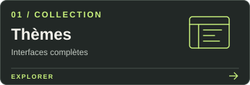</a></td>
<td width="50%"><a href="collections/design-systems/README.md">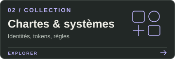</a></td>
</tr>
<tr>
<td width="50%"></td>
<td width="50%"></td>
</tr>
<tr>
<td width="50%"><a href="collections/motion/README.md">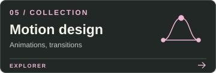</a></td>
<td width="50%"><a href="collections/typography/README.md">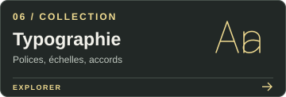</a></td>
</tr>
<tr>
<td width="50%"><a href="collections/assets/README.md">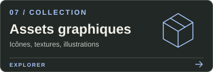</a></td>
<td width="50%"><a href="collections/inspiration/README.md">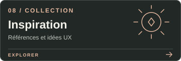</a></td>
</tr>
</table>

## Galerie

Un aperçu pour chaque ressource, une fiche dédiée et les fichiers associés lorsque leur licence le permet.

<!-- gallery:start -->
<table>
<tr>
<td width="50%" valign="top"><a href="collections/themes/axiom-ui/README.md">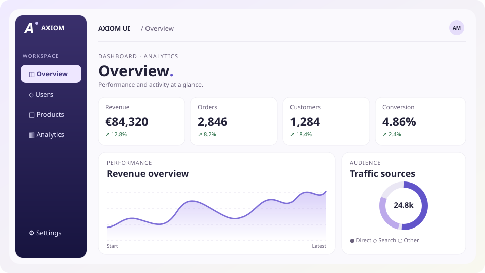 <strong>Axiom UI</strong></a> Dashboard React modulaire : KPI, graphiques accessibles, densité et navigation personnalisables. Réutilisable · react · dashboard · typescript</td>
<td width="50%" valign="top"><a href="collections/design-systems/forma-ui/README.md">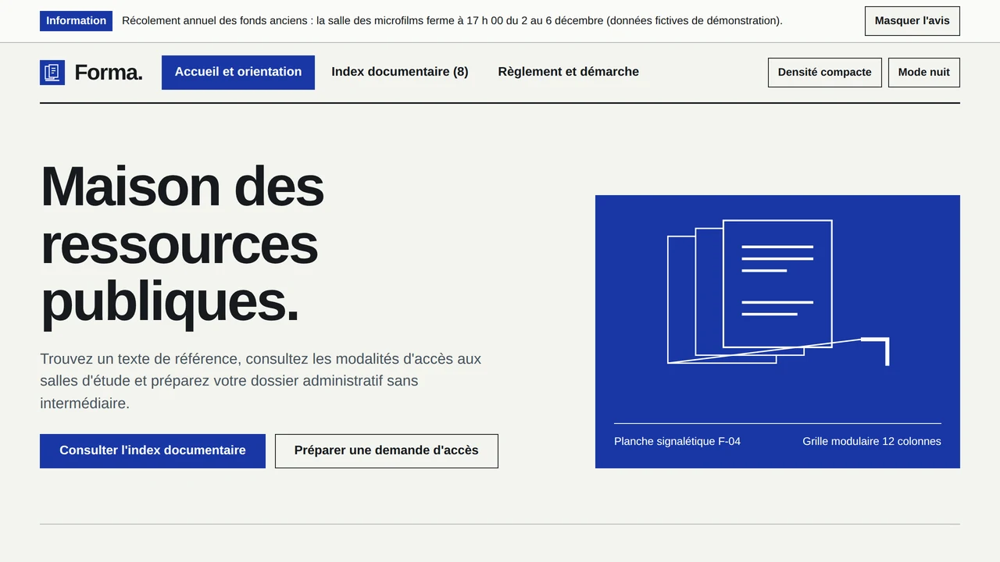 <strong>Forma UI</strong></a> Direction suisse : sites institutionnels, index éditoriaux et centres de ressources. Référence · institutional · editorial · typography · prototype · accessibility</td>
</tr>
<tr>
<td width="50%" valign="top"><a href="collections/design-systems/lumera-ui/README.md">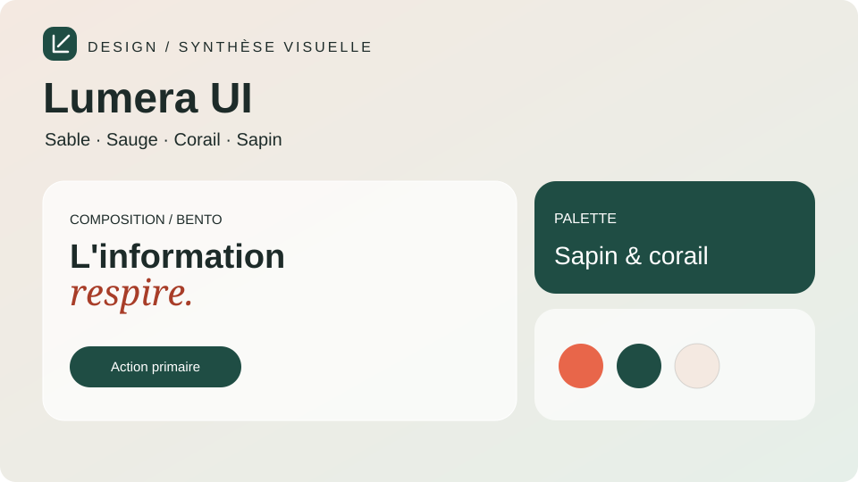 <strong>Lumera UI</strong></a> Design system Bento éditorial : verre chaud, sable et sauge, surfaces accessibles et prototype interactif. Référence · bento · glassmorphism · tokens · editorial</td>
<td width="50%" valign="top"><a href="collections/design-systems/nexora-ui/README.md">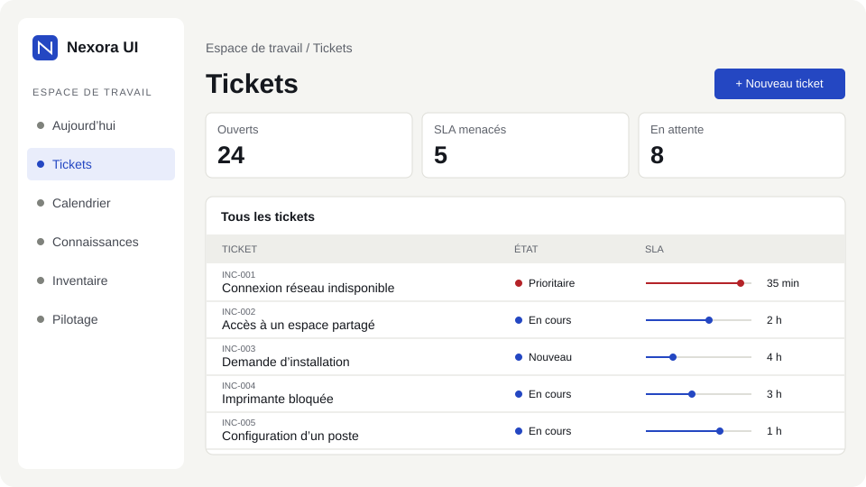 <strong>Nexora UI</strong></a> Design system ITSM : navigation configurable, tableaux à trois densités, états métier et thèmes clair/sombre. Référence · itsm · tokens · design-system · accessibility</td>
</tr>
<tr>
<td width="50%" valign="top"><a href="collections/design-systems/velora-ui/README.md">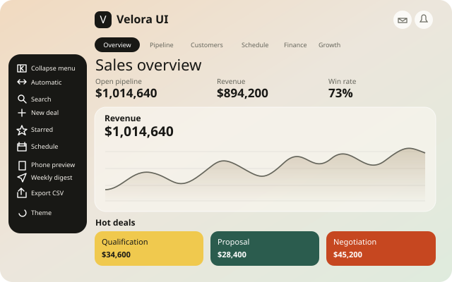 <strong>Velora UI</strong></a> Charte UX/UI éditoriale : toile pêche-sauge, cartes métier colorées, transitions et surfaces givrées. Référence · crm · motion · tokens · prototype</td>
<td width="50%" valign="top"><a href="collections/components/glassy-otp/README.md">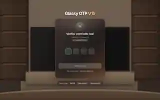 <strong>Glassy OTP</strong></a> Composant OTP animé en verre fumé, saisie à quatre chiffres et validation lumineuse. Référence · react · otp · motion · glassmorphism</td>
</tr>
<tr>
<td width="50%" valign="top"><a href="collections/assets/loup-cyberpunk/README.md">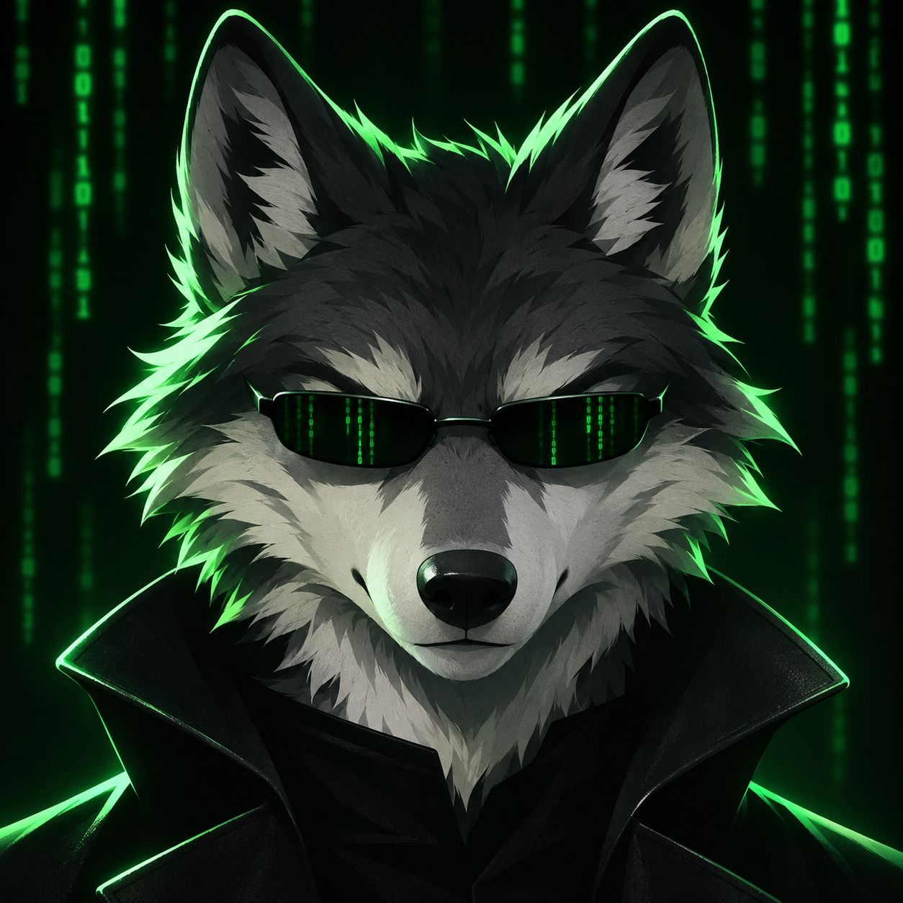 <strong>Loup cyberpunk</strong></a> Illustration de loup cyberpunk, atmosphère Matrix et code vert. Référence · avatar · cyberpunk · illustration · matrix</td>
<td width="50%"></td>
</tr>
</table>
<!-- gallery:end -->

## Des identités pour chaque usage

**Axiom UI** pour les dashboards analytiques, **Lumera UI** pour les interfaces éditoriales et Bento, **Nexora UI** pour la gestion de services, **Velora UI** pour les expériences CRM fluides. **Forma UI** pour les sites institutionnels et les centres de ressources. Chaque identité conserve son propre langage visuel.

[Design Studio : feuille de route et méthode de création](STUDIO.md)

## L'esprit de la collection

Observer ce qui fonctionne. Comprendre les choix de design. Retrouver les bonnes références au moment de concevoir.

Chaque entrée conserve sa source, ses droits d'utilisation, son contexte et ce qui mérite d'être retenu : lisibilité, composition, hiérarchie, interactions, couleurs ou mouvement. Les références et les ressources réellement réutilisables sont distinguées.

Les visuels de navigation sont intégrés au dépôt, sans service externe. Le catalogue est construit à partir des fiches de ressources avec une commande locale, sans dépendance ni GitHub Actions.

---

NEOSODA &nbsp; / &nbsp; DESIGN ARCHIVE &nbsp; / &nbsp; 2026

