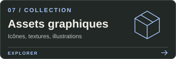

<a href="../../README.md">← Toutes les collections</a>

# Assets graphiques

Icônes, textures, illustrations. Cette collection accueille les ressources de cette famille, chacune dans son propre dossier.

## Galerie

<!-- gallery:start -->
*Aucune ressource pour le moment.*
<!-- gallery:end -->

[Guide de classement](../../CONTRIBUTING.md)
