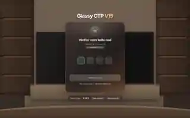

[← Collection](../README.md) · [Toutes les ressources](../../../README.md)

# Glassy OTP

Composant OTP animé en verre fumé, saisie à quatre chiffres et validation lumineuse.

## Ressources

- [Documentation](files/README.md)
- [Démo HTML autonome](files/preview.html)
- [Prompt d'intégration](files/PROMPT.md)
- [Composant React](files/components/GlassyOtp.tsx)
- [Configuration](files/config/glassy-otp.json)

Recréation libre, et non le code source original de la vidéo de référence. Miniature : capture Chromium du prototype.

## Provenance et droits

- Source : Glassy-OTP-Kit.zip + prompt OTP.md (collection personnelle)
- Licence : Inconnue
- Statut : Référence ; vérifier les droits avant toute réutilisation.
