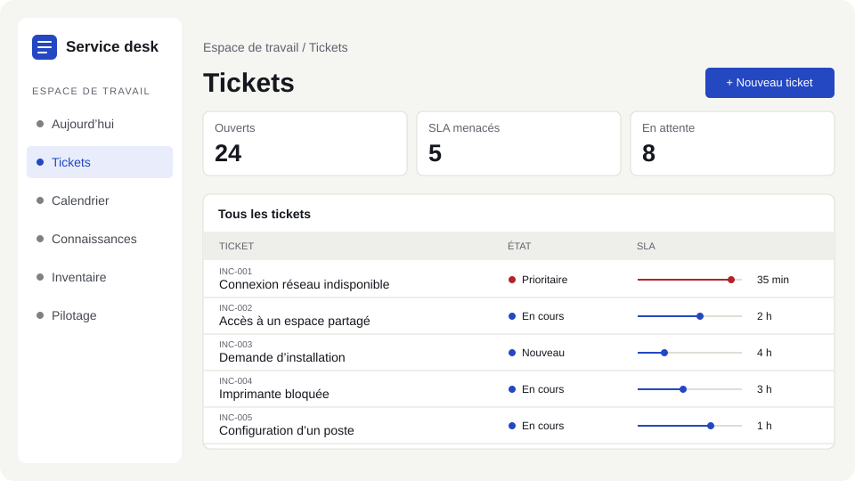

<a href="../../README.md">← Toutes les collections</a>

# Chartes & systèmes

Identités, tokens, règles. Cette collection accueille les ressources de cette famille, chacune dans son propre dossier.

## Galerie

<!-- gallery:start -->
<table>
<tr>
<td width="50%" valign="top"><a href="service-desk-ui/README.md"> <strong>Service Desk UI · Design System</strong></a> Interface ITSM générique : tableaux denses, états métier, thèmes clair et sombre, composants et tokens. Référence · itsm · tokens · design-system · accessibility</td>
<td width="50%" valign="top"><a href="velora-ui/README.md"> <strong>Velora UI</strong></a> Charte UX/UI éditoriale : toile pêche-sauge, cartes métier colorées, transitions et surfaces givrées. Référence · crm · motion · tokens · prototype</td>
</tr>
<tr>
<td width="50%" valign="top"><a href="warm-frosted-editorial/README.md"> <strong>Warm Frosted Editorial</strong></a> Charte Bento lumineuse : verre dépoli chaud, sable, sauge, sapin et corail. Référence · bento · glassmorphism · tokens · editorial</td>
<td width="50%"></td>
</tr>
</table>
<!-- gallery:end -->

[Guide de classement](../../CONTRIBUTING.md)
