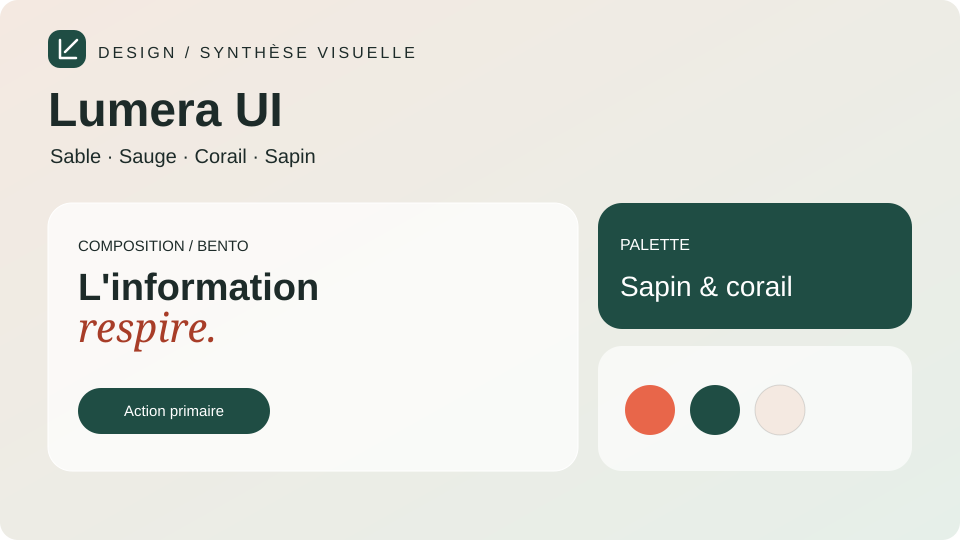
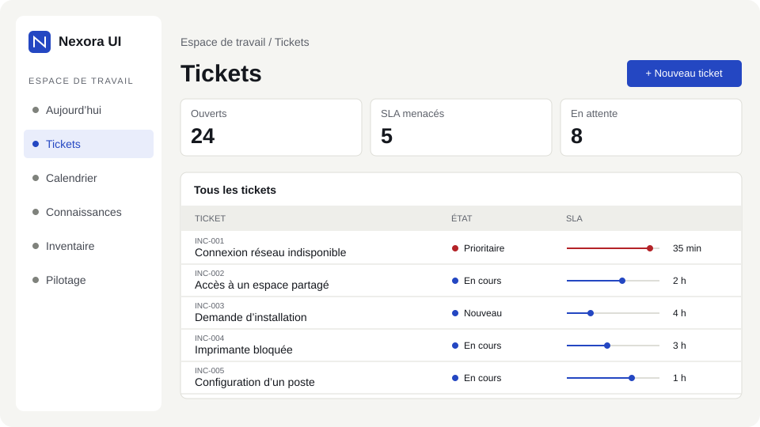
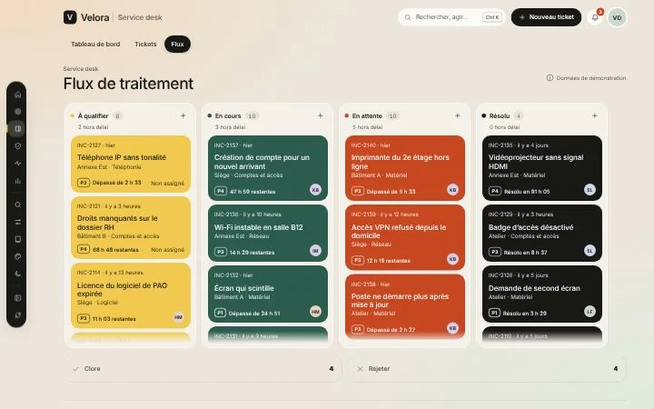

<a href="../../README.md">← Toutes les collections</a>

# Chartes & systèmes

Identités, tokens, règles. Cette collection accueille les ressources de cette famille, chacune dans son propre dossier.

## Galerie

<!-- gallery:start -->
<table>
<tr>
<td width="50%" valign="top"><a href="forma-ui/README.md"> <strong>Forma UI</strong></a> Direction suisse : sites institutionnels, index éditoriaux et centres de ressources. Référence · institutional · editorial · typography · prototype · accessibility</td>
<td width="50%" valign="top"><a href="lumera-ui/README.md"> <strong>Lumera UI</strong></a> Design system Bento éditorial : verre chaud, sable et sauge, surfaces accessibles et prototype interactif. Référence · bento · glassmorphism · tokens · editorial</td>
</tr>
<tr>
<td width="50%" valign="top"><a href="nexora-ui/README.md"> <strong>Nexora UI</strong></a> Design system ITSM : navigation configurable, tableaux à trois densités, états métier et thèmes clair/sombre. Référence · itsm · tokens · design-system · accessibility</td>
<td width="50%" valign="top"><a href="velora-ui/README.md"> <strong>Velora UI</strong></a> Design system éditorial V4 : toile pêche-sauge, surfaces givrées, objets colorés par étape, motion interruptible, Studio et 5 modèles métier. Référence · design-system · tokens · motion · crm · itsm · dashboard · accessibility</td>
</tr>
</table>
<!-- gallery:end -->

[Guide de classement](../../CONTRIBUTING.md)
