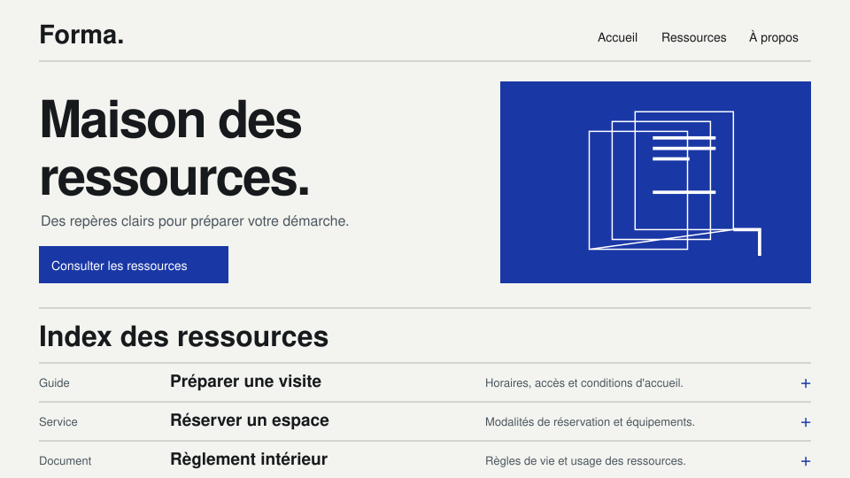

[Retour à la collection](../README.md) · [Design Studio](../../../STUDIO.md)

# Forma UI

Design institutionnel suisse : surfaces planes, index éditorial, typographie et signalétique outremer. Un thème adapté aux sites publics, documentation et portails de ressources.

- [Prototype HTML autonome](files/prototype.html) (télécharger le Raw et ouvrir localement)
- [Charte UX/UI](files/DESIGN.md)
- [Tokens CSS](files/tokens.css) et [composants](files/components.css)
- [Skill pour agents IA](files/SKILL.md)
- [Recette](files/QA.md)

Prototype initial : recherche, filtres, réinitialisation et détails natifs ; contenu fictif. Aperçu vectoriel illustratif, pas une capture de navigateur. Création originale pour le dépôt ; licence de réutilisation à définir par le propriétaire.
