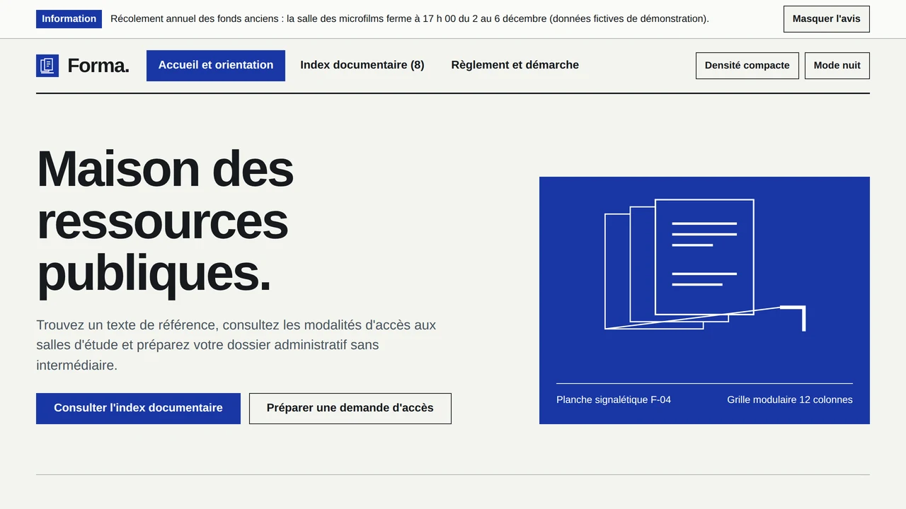

[Retour à la collection](../README.md) · [Design Studio](../../../STUDIO.md)

# Forma UI

Direction artistique de **signalétique suisse contemporaine** pour sites institutionnels, portails publics, centres d'archives et bases documentaires : surfaces planes à angles stricts (`0 px`), filets structurels `1 px` / `2 px`, grilles asymétriques, typographie néo-grotesque et signalétique outremer.

## Livrables

- [Prototype HTML autonome à 3 surfaces](files/prototype.html) — portail d'orientation, index documentaire filtrable et démarche réglementaire interactive (clair / nuit, densité standard / compacte).
- [Charte graphique et éditoriale complète](files/DESIGN.md)
- [Skill pour agents IA](files/SKILL.md) et [Prompt d'intégration directe](files/PROMPT.md)
- [Tokens JSON (3 couches)](files/tokens.json), [Tokens CSS](files/tokens.css), [Composants CSS](files/components.css) et [Motion CSS](files/motion.css)
- [Adaptateur Tailwind CSS v4 & shadcn/ui](files/examples/shadcn-tailwind.css) et [Logotype SVG](files/assets/forma-mark.svg)
- [Suite de tests Playwright E2E](files/tests/smoke.py) et [Journal de recette navigateur](files/QA.md)

L'aperçu `preview.webp` est une capture réelle Chromium (`1280 × 720`) du prototype exécuté ; l'aperçu vectoriel initial [`preview.svg`](preview.svg) est également préservé. Contenus de démonstration explicitement fictifs ; création originale pour le dépôt (licence de réutilisation à définir par le propriétaire).
