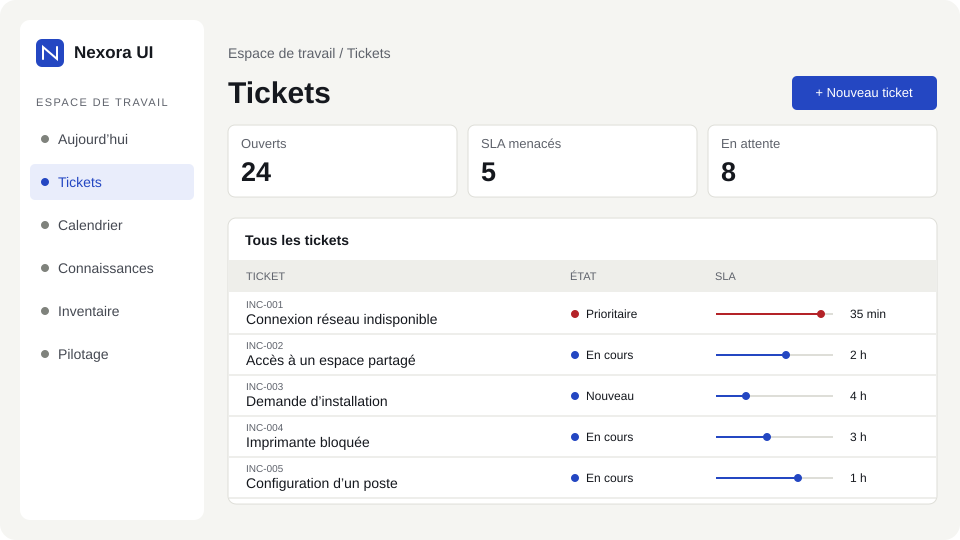

[← Collection](../README.md) · [Toutes les ressources](../../../README.md)

# Nexora UI

Interface ITSM générique : tableaux denses, états métier, thèmes clair et sombre, composants et tokens.

*Clarity in every action.*

Menu réglable (automatique, compact, déplié), densité de tableau et thème mémorisés. Le prototype conserve les parcours métier.

## Ressources

- [Guide UX/UI](files/DESIGN.md)
- [Prototype HTML autonome](files/prototype.html)
- [Tokens JSON](files/tokens.json) et [CSS](files/tokens.css)
- [Composants CSS](files/components.css)
- [Marqueurs d'interface JavaScript](files/nexora-ui-marks.js) et [types](files/nexora-ui-marks.d.ts)
- [Adaptation Tailwind](files/tailwind.css) et [shadcn/ui](files/shadcn-theme.css)
- [Rapport de contraste](files/contrast-report.md)

Aperçu : reconstruction graphique neutre, non une capture du prototype. Le kit utilise des données fictives, une identité visuelle Nexora UI et des polices locales ou système. Les anciennes marques et captures ne sont pas incluses.

## Provenance et droits

- Source : collection personnelle, version neutralisée
- Licence : Inconnue
- Statut : Référence ; vérifier les droits avant toute réutilisation.
