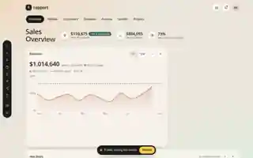

[← Collection](../README.md) · [Toutes les ressources](../../../README.md)

# Rapport · CRM

Charte UX/UI éditoriale : toile pêche-sauge, cartes métier colorées, transitions et surfaces givrées.

Le menu latéral des deux prototypes HTML dispose de trois modes mémorisés : compact (icônes seules), déplié permanent et automatique (survol/focus).

## Ressources

- [Charte V3](files/v3/CHARTE.md)
- [Tokens V3](files/v3/tokens.css)
- [Prototype V3](files/v3/prototype.html)
- [Charte V2](files/v2/CHARTE.md)
- [Tokens V2](files/v2/tokens.css)
- [TemplateTheme HTML](files/TemplateTheme.html)

Miniature : capture Chromium du prototype V3. Les captures vidéo originales et les pages HTML intégrant ces captures ne sont pas republiées. Les versions V2 et V3 restent séparées.

## Provenance et droits

- Source : rapport-ux-ui-v3.zip + charte-ux-ui-rapport-v2.zip + TemplateTheme.html (collection personnelle)
- Licence : Inconnue
- Statut : Référence ; vérifier les droits avant toute réutilisation.
