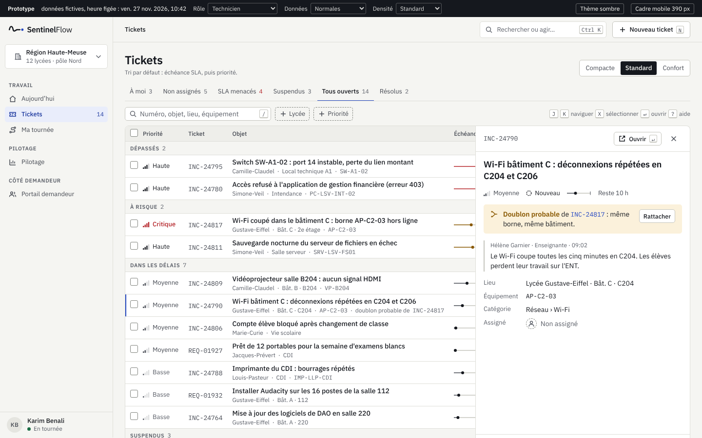

[← Collection](../README.md) · [Toutes les ressources](../../../README.md)

# SentinelFlow · Identité V1

Référentiel ITSM : identité de marque, tokens, composants, contrastes et écrans métier.

## Ressources

- [Référentiel DESIGN.md](files/DESIGN.md)
- [Prototype HTML](files/sentinelflow-prototype.html)
- [Tokens JSON](files/tokens.json) et [CSS](files/tokens.css)
- [Composants CSS](files/components.css)
- [Logotypes SVG](files/logos/)
- [Écrans complémentaires](previews/)
- [Rapport de contraste](files/contrast-report.md)

Aperçu : écran tickets fourni dans le référentiel. Le prototype est conservé sans les polices embarquées (fallback système ; installer IBM Plex localement pour retrouver le rendu exact). Les variantes raster et captures non sélectionnées restent dans l'archive Drive.

## Provenance et droits

- Source : SentinelFlow-referentiel-v1.zip (collection personnelle)
- Licence : Inconnue
- Statut : Référence ; vérifier les droits avant toute réutilisation.
