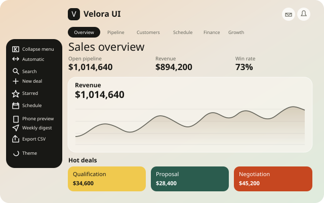

[← Collection](../README.md) · [Toutes les ressources](../../../README.md)

# Velora UI

Charte UX/UI éditoriale : toile pêche-sauge, cartes métier colorées, transitions et surfaces givrées.

Le menu latéral des deux prototypes HTML dispose de trois modes mémorisés : compact (icônes seules), déplié permanent et automatique (survol/focus).

*Soft by nature, fluid by design.*

## V4 · nouvelle génération

[Prototype interactif V4](files/v4/prototype.html) · [Guide V4 et composants](files/v4/README.md)

Studio de personnalisation, quatre palettes, dashboard configurable, cinq profils métier, palette d’actions, centre d’activité et Playground. La V3 reste disponible comme référence historique.

## Ressources

- [Charte V3](files/v3/CHARTE.md)
- [Tokens V3](files/v3/tokens.css)
- [Prototype V3](files/v3/prototype.html)
- [Charte V2](files/v2/CHARTE.md)
- [Tokens V2](files/v2/tokens.css)
- [TemplateTheme HTML](files/TemplateTheme.html)

Miniature : aperçu vectoriel du prototype V3, illustrant le menu déplié. Les captures vidéo originales et les pages HTML intégrant ces captures ne sont pas republiées. Les versions V2 et V3 restent séparées.

## Provenance et droits

- Source : rapport-ux-ui-v3.zip + charte-ux-ui-rapport-v2.zip + TemplateTheme.html (collection personnelle)
- Licence : Inconnue
- Statut : Référence ; vérifier les droits avant toute réutilisation.
