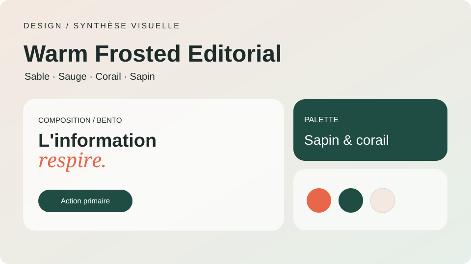

[← Collection](../README.md) · [Toutes les ressources](../../../README.md)

# Warm Frosted Editorial

Charte Bento lumineuse : verre dépoli chaud, sable, sauge, sapin et corail.

## Ressources

- [Charte graphique et design system](files/CHARTE.md)
- [Prompt de transposition](files/PROMPT.md)

Aperçu : synthèse graphique originale fondée sur les tokens documentés, pas une capture du synoptique d'origine.

## Provenance et droits

- Source : charte Bento.txt + prompt charte bento.md (collection personnelle)
- Licence : Inconnue
- Statut : Référence ; vérifier les droits avant toute réutilisation.
