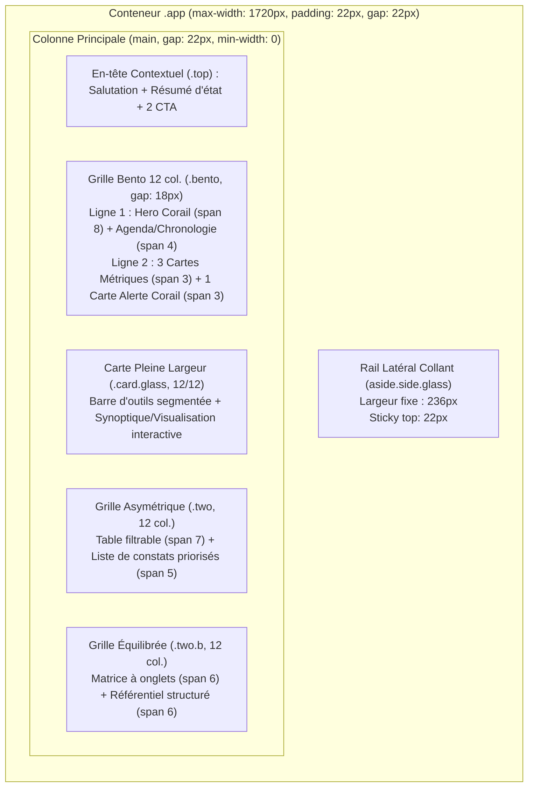

# Charte Graphique & Design System : « Warm Frosted Editorial » (ADN TechSentinel)

Cette charte graphique codifie l'intégralité de l'identité visuelle, de l'architecture spatiale, des composants interactifs et du ton éditorial extraits de [Synoptique TechSentinel.html](Synoptique%20TechSentinel.html). Elle est structurée selon les standards **Design System (Tokens à 3 couches)**, **Hallmark (extraction d'ADN & verrouillage des tokens)** et **Anti-Slop IA (R-01 à R-38)**.

> [!IMPORTANT]
> **Signature visuelle en une phrase :** Une interface lumineuse en verre dépoli chaud (`blur 18px`) posée sur un fond organique bi-température (sable argileux `#f4e9e1` vers sauge brumeuse `#e6efe9`), structurée par une encre sapin profond (`#1d2b29` / `#1f4d44`), réveillée par un accent corail terracotta (`#e8664a`) et humanisée par le contraste typographique entre le sans-serif géométrique **Manrope ExtraBold**, la touche éditoriale **Instrument Serif Italic** et la précision technique **JetBrains Mono**.

---

## 1. Philosophie, Calibrage & Pourquoi ce Design est Anti-Slop

La plupart des interfaces générées par IA tombent dans deux pièges : le cliché « Dark Tech » (fond noir `#0B0B0B`, dégradés bleu-violet néon, lueurs partout) ou le cliché « SaaS Stérile » (fond blanc plat `#FFFFFF`, bordures grises `#E5E7EB`, police Inter, cartes identiques).

L'ADN **TechSentinel** échappe à ces deux travers grâce à 5 choix délibérés (conformes à la règle `R-31` d'Antislop) :

| Décision | Choix TechSentinel | Raison fonctionnelle & identitaire (Purpose-Gate) |
| :--- | :--- | :--- |
| **Mode lumineux organique** | Fond dégradé chaud/frais `#f4e9e1` → `#e6efe9` avec halos radiaux pêche et sauge | Évite la froideur hospitalière du blanc pur et la fatigue visuelle du mode sombre par défaut (`R-21`). Donne une matière réelle au verre dépoli. |
| **Ombres teintées & filet spéculaire** | `0 1px 0 rgba(255,255,255,.9) inset` + `0 18px 40px -22px rgba(60,40,30,.28)` | Une ombre grise (`rgba(0,0,0,.1)`) salit un fond chaud. L'ombre terre d'ombre (`rgba(60,40,30,.28)`) ancre les cartes comme des plaques de verre physique. |
| **Duo Corail + Sapin** | Accent actif Corail `#e8664a` + Structure Sapin `#1f4d44` | Deux couleurs complémentaires chaudes/naturelles : le Sapin stabilise la structure et les CTA primaires sombres, le Corail capte l'attention sur l'état vital et les alertes (`R-29`). |
| **Typographie 2+1** | `Manrope` (UI/Titres) + `Instrument Serif Italic` (mot-clé `h2`) + `JetBrains Mono` (données) | `Manrope 800` apporte une autorité moderne, `Instrument Serif` injecte une respiration éditoriale humaine sur un seul mot-clé par titre de section, et `JetBrains Mono` isole la donnée brute (`R-06`). |
| **Zéro élément décoratif mort** | Filtres, recherche, onglets, calques SVG et scroll-spy 100 % câblés | Chaque pilule, bouton ou jauge porte une vraie donnée ou déclenche un filtrage réel (`R-24`, `R-26`, `C-2`). |

### Réglage des Cadrans (Antislop Liveliness Dials)
* **ENERGY : 2 / 3 (Équilibré & Chaleureux)** : Une carte Hero corail saturée par écran principal, entourée de surfaces vitrées calmes et très lisibles.
* **RHYTHM : 3 / 3 (Asymétrique & Varié)** : Grille Bento 12 colonnes qui alterne les rapports (`8+4`, `3+3+3+3`, `12`, `7+5`, `6+6`) selon la nature réelle du contenu (`R-05`).
* **MOTION : 2 / 3 (Fonctionnel & Chorégraphié)** : Micro-élévation au survol (`translateY(-1px)`), transition d'opacité pour l'isolation de contexte (`.2s`), flux SVG animés en pointillés (`1.6s linear`) avec désactivation automatique sous `prefers-reduced-motion: reduce` (`R-19`).

---

## 2. Palette de Couleurs & Ratios WCAG Vérifiés

### 2.1 Couleurs de Fond & Surfaces Vitrées (Canvas & Glass)

| Token CSS | Nom | Valeur Hex / RGBA | RGB / OKLCH approx. | Rôle exact |
| :--- | :--- | :--- | :--- | :--- |
| `--bg-1` | Sable Argileux | `#f4e9e1` | `rgb(244, 233, 225)` · `oklch(93.8% 0.019 52)` | Pôle chaud du fond (haut/gauche) |
| `--bg-2` | Sauge Brumeuse | `#e6efe9` | `rgb(230, 239, 233)` · `oklch(94.3% 0.015 155)` | Pôle frais du fond (bas/droite) |
| `--bg-aura-warm` | Halo Pêche | `#f7d6c4` | `rgb(247, 214, 196)` · `oklch(89.5% 0.045 48)` | Radial gradient `1100px 700px at 8% -10%` |
| `--bg-aura-cool` | Halo Menthe Sauge | `#d4e8dc` | `rgb(212, 232, 220)` · `oklch(91.4% 0.028 154)` | Radial gradient `900px 700px at 100% 20%` |
| `--glass` | Verre Dépoli | `rgba(255, 255, 255, .62)` | Blanc 62 % + `blur(18px) saturate(1.2)` | Surface principale des cartes (`.card`, `.side`, `.stat`) |
| `--glass-strong` | Verre Dense | `rgba(255, 255, 255, .86)` | Blanc 86 % | Sous-cartes, champs de saisie, boutons, événements |
| `--edge` | Arête Spéculaire | `rgba(255, 255, 255, .90)` | Blanc 90 % | Bordure `1px solid` externe des surfaces vitrées |
| `--line` | Filet Structurel | `rgba(31, 52, 48, .10)` | Sapin 10 % | Séparateurs internes, bordures de lignes de tableaux |

### 2.2 Encre, Structure & Accent de Marque

| Token CSS | Nom | Hex | RGB | Ratio WCAG (vérifié) | Rôle & Règles d'usage |
| :--- | :--- | :--- | :--- | :--- | :--- |
| `--ink` | Encre Sapin Noir | `#1d2b29` | `rgb(29, 43, 41)` | **14.69:1** (sur `#fff`) / **12.30:1** (sur `--bg-1`) · **AAA** | Texte principal, titres, valeurs numériques, icônes |
| `--muted` | Ardoise Sauge | `#6b7a76` | `rgb(107, 122, 118)` | **4.50:1** (sur `#fff`) · **AA** | Légendes, sous-titres, métadonnées sur fond blanc/dense |
| `--muted-strong` | Ardoise Dense *(recommandé AA strict sur verre)* | `#576662` | `rgb(87, 102, 98)` | **6.03:1** (sur `#fff`) / **5.05:1** (sur `--bg-1`) · **AA** | Texte secondaire < 14px posé directement sur `--glass` |
| `--pine` | Vert Sapin Structurel | `#1f4d44` | `rgb(31, 77, 68)` | **9.53:1** (texte `#fff`) · **AAA** | Boutons primaires sombres (`.btn.dark`), filtres actifs (`.tg.dk`), bus réseau, composants clés |
| `--coral` | Corail Terracotta | `#e8664a` | `rgb(232, 102, 74)` | **4.50:1** (avec `--ink`) / **3.27:1** (texte `#fff` >= 18px bold) | Accent identitaire, anneau `:focus-visible`, mots en italique serif, compteurs, cartes Hero/Alerte |
| `--coral-2` | Ambre Pêche | `#f39a6b` | `rgb(243, 154, 107)` | Départ de dégradé | Pôle lumineux des dégradés Hero (`#f08a63` → `#e5603f` → `#cf4a33`) |

### 2.3 Palette Sémantique & Catégorielle (Flux, Tags, Schémas & États)

Chaque catégorie fonctionnelle ou état possède un couple harmonisé **(Teinte vive + Surface pastel + Bordure pastel)** afin que les tableaux, badges et schémas restent lisibles sans jamais saturer l'oeil :

| Catégorie / État | Token Couleur Vive | Surface Pastel (Carte / Puce) | Bordure / Anneau Pastel | Usage type (Universel) |
| :--- | :--- | :--- | :--- | :--- |
| **Primaire / Frontal / Web** | `--coral: #e8664a` | `#fff7f3` (clé : `#fff3ee`, tag : `#fff0ea`) | `#f6cbb9` (texte tag : `#c4502f`) | Point d'entrée, action principale, flux public |
| **Routage / API / Données / Info** | `--route: #3d6fd6` | `#eef3ff` (data : `#f1f3fa`, info : `#e5edff`) | `#c8d6f6` / `#d3dbef` | Flux de données, backend, note d'information (`i`) |
| **Tunnel / Privé / IA / Logique** | `--tun: #7b57d6` | `#f4f0ff` (IA : `#f6f3ff`) | `#cbbcf3` | Connexions inter-services, pipelines IA, workers |
| **Sauvegarde / Succès / Actif** | `--bak` / `--ok: #2e9a68` | `#eef8f2` (chip : `#eaf6ef`, ok : `#e1f3e9`) | `#b9dfc9` (texte tag : `#23795a`) | État nominal (`✓`), stockage, validation, disponibilité |
| **Supervision / Télémétrie** | `--mon: #178e88` | `#ecf7f6` (chip : `#e8f5f4`) | `#b5dcd9` | Cron, monitoring, observabilité, métriques temps réel |
| **Annuaire / Configuration / DNS** | `--dns: #c38a1c` | `#fdf6e6` | `#c38a1c` | Paramétrage, indexation, résolution, routage interne |
| **Avertissement / Vigilance** | `--warn: #d9901f` | `#fff8ec` (chip : `#fff6e6`, alerte : `#fdf0d9`) | `#f0cf8e` | Seuil > 65 %, exposition à surveiller (`!`) |
| **Critique / Erreur / Rupture** | `--crit: #d8433a` | `#fff1f0` (alerte : `#fde4e2`) | `#d8433a` (`stroke-dasharray: 5 4`) | Panne, erreur 502, élément arrêté, action corrective urgente (`!`) |

---

## 3. Système Typographique « 2+1 » & Règles Éditoriales

### 3.1 Import & Déclaration des Polices

```html
<link rel="preconnect" href="https://fonts.googleapis.com">
<link rel="preconnect" href="https://fonts.gstatic.com" crossorigin>
<link href="https://fonts.googleapis.com/css2?family=Manrope:wght@400;500;600;700;800&family=Instrument+Serif:ital@1&family=JetBrains+Mono:wght@400;500&display=swap" rel="stylesheet">
```

```css
:root {
  --display: "Manrope", "Segoe UI", system-ui, sans-serif;
  --serif:   "Instrument Serif", Georgia, serif;
  --mono:    "JetBrains Mono", ui-monospace, Consolas, monospace;
}
```

### 3.2 Hiérarchie & Échelle Typographique

| Élément | Police | Graisse | Taille | Interlignage & Approche | Règles spécifiques |
| :--- | :--- | :--- | :--- | :--- | :--- |
| **Titre de page (`h1`)** | `--display` (Manrope) | `800` (ExtraBold) | `clamp(28px, 3vw, 40px)` | `line-height: 1.1` · `letter-spacing: -0.02em` | `text-wrap: balance`, jamais d'italique dans `h1` |
| **Titre Hero (`hero h2`)** | `--display` + `--serif` | `800` (`em` en `400 italic`) | `clamp(30px, 3.3vw, 44px)` | `line-height: 1.05` · `letter-spacing: -0.02em` | Un seul groupe de mots en `<em>` (`1.1em`, blanc) |
| **Titre de Carte (`card h2`)** | `--display` + `--serif` | `800` (`em` en `400 italic`) | `21px` | `line-height: 1.2` · `letter-spacing: -0.01em` | Le mot en `<em>` prend `font-size: 1.15em; color: var(--coral)` |
| **Chiffre Clé / KPI (`.big`, `.day`, `.ring b`)** | `--display` | `700` à `800` | `28px` / `36px` / `48px` | `line-height: 1.0` · `letter-spacing: -0.02em` à `-0.03em` | Toujours `font-variant-numeric: tabular-nums` |
| **Corps & Paragraphes (`body`)** | `--display` | `400` à `500` | `15px` (cartes : `13px`–`14px`) | `line-height: 1.5` | Mesure bornée (`max-width: 46ch` dans le Hero, `110ch` en légende) |
| **Boutons & Navigation (`.btn`, `nav a`)** | `--display` | `600` (SemiBold) | `13.5px` à `14px` | `line-height: 1.2` | Casse phrase naturelle (jamais de tout-majuscules sur les boutons) |
| **En-têtes de section / Tableaux (`.navlbl`, `th`)** | `--display` | `700` (Bold) | `10.5px` à `11px` | `letter-spacing: 0.07em` à `0.12em` · ` uppercase` | Usage strictement réservé aux en-têtes de colonnes `th` et séparateurs de menu |
| **Données techniques (`.mono`, `time`, IP, ports)** | `--mono` (JetBrains Mono) | `400` à `500` | `10.5px` à `12.5px` | `line-height: 1.3` | IPs, ports, horaires, chemins fichiers, pourcentages de jauges |

> [!TIP]
> **Règle du Motif Identitaire (`Instrument Serif Italic`) :**
> Dans chaque titre de section `h2` (`Synoptique <em>réseau</em>`, `Routage <em>public</em>`, `Points <em>d'attention</em>`), le second terme ou le qualificatif porte une balise `<em>` en **Instrument Serif Italic** (`1.15em`, couleur `--coral` sur carte claire, `#fff` sur carte Hero). **Dose maximale (Purpose-Gate) :** uniquement sur les `h2`, jamais sur `h1`, jamais sur les boutons, jamais dans les paragraphes.

---

## 4. Architecture Spatiale, Grille Bento & Hiérarchie des Rayons

### 4.1 Structure Macroscopique (`.app`)



### 4.2 Échelle des Rayons de Courbure (`border-radius`)

Contrairement au slop IA où tout est soit `rounded-lg` uniforme soit `999px` partout (`R-11`), le rayon de courbure dépend du **niveau d'imbrication** :

1. **Niveau 1 · Conteneurs Racines (`--r-lg: 26px`)** : `.glass`, `aside.side`, `.hero`, `.card`, `.stat`, `.sched` (et `rx: 24px` pour les grands hôtes SVG `.hbox`).
2. **Niveau 2 · Fenêtres de Contenu Internes (`18px` – `20px`)** : `.diagram` (`20px`), `.tablebox` (`18px`), éléments de constat `li.f` (`18px`).
3. **Niveau 3 · Briques Événementielles & Noeuds (`14px` – `16px`)** : lignes d'agenda `.evt` (`16px`), boîtes SVG `.nbox` (`16px`), liens de menu `nav.menu a` (`14px`), lignes d'hôtes `.hostrow` (`14px`), composants SVG `.cbox` (`14px`).
4. **Niveau 4 · Micro-Conteneurs (`10px` – `12px`)** : carré de logo `.logo` (`12px`), jours du calendrier `.week div` (`12px`), puces SVG `.chip rect` (`10px`).
5. **Niveau 5 · Jauges Linéaires (`4px`)** : barres de progression `.meter i` (`4px`).
6. **Niveau 6 · Contrôles Interactifs & Badges (`999px` Capsule)** : boutons `.btn`, groupes segmentés `.seg` et leurs boutons `button.tg`, champs `input[type=search]` et `select`, badges `.tagpill`, `.badge`, `.tag`, `.count`.

---

## 5. Spécifications des Composants Clés

### 5.1 Carte Hero Corail (`.hero`)
* **Surface :** `background: radial-gradient(500px 300px at 85% 30%, rgba(255,255,255,.22), transparent 60%), linear-gradient(135deg, #f08a63 0%, #e5603f 55%, #cf4a33 100%)`
* **Ombre portée colorée :** `box-shadow: 0 30px 60px -30px rgba(207, 74, 51, .7)` (seul élément de la page autorisé à porter une ombre colorée saturée : `R-12`, `R-13`).
* **Composition interne :** Grille `minmax(0, 1fr) 240px`.
  * *Colonne gauche :* Badge capsule `.tagpill` translucide + Titre `h2` avec `<em>` en Instrument Serif + Paragraphe synthèse (`max-width: 46ch`) + Bandeau de 3 compteurs `.nums` séparés par un filet vertical `1px solid rgba(255,255,255,.35)` + 2 boutons d'action (`.btn` blanc plein + `.btn.ghost` bordure blanche translucide).
  * *Colonne droite :* Jauge annulaire SVG `.ring` (`240x240px`) entourée de 4 pastilles satellites `.av` (`46x46px`, fond blanc, monogramme `800` coloré par domaine, bordure `3px solid rgba(255,255,255,.75)`).

### 5.2 Cartes Métriques (`.stat.glass`) & Carte Alerte (`.stat.glass.alert`)
* **En-tête de carte :** Pastille circulaire `.ic` (`40x40px`, fond `#fff`, ombre douce, monogramme `11px` en `font-weight: 800` coloré) à gauche + badge d'état `.badge` en haut à droite (`background: rgba(46,154,104,.14); color: var(--ok)`).
* **Corps :** Grand chiffre `.big` (`36px`, `800`, `tabular-nums`) suivi de son unité `<small>` (`15px`, `--muted`), titre `.ttl` (`14px`, `700`) et sous-titre `.sub` (`12.5px`, `--muted`).
* **Pied (Jauges `.meter`) :** Grille `62px 1fr 42px` (Libellé + Piste `6px` `rgba(31,77,68,.1)` avec remplissage CSS `--v` et couleur `--c` + Valeur en `--mono`).
* **Variante Alerte (`.stat.alert`) :** Fond `linear-gradient(140deg, #ef7d58, #d9503a)`, texte blanc, cliquable (`<a href="#alertes">`), liste à puces synthétique des 3 urgences.

### 5.3 Contrôles Segmentés & Filtres de Calques (`.seg` + `button.tg`)
* **Conteneur `.seg` :** `background: rgba(31,77,68,.07); padding: 4px; border-radius: 999px; display: inline-flex; gap: 4px`.
* **Bouton `.tg` :**
  * État inactif (`aria-pressed="false"`) : fond transparent, texte `var(--muted)`, pastille de couleur `i` atténuée à `opacity: .3`.
  * État actif clair (`aria-pressed="true"`) : `background: #fff; color: var(--ink); box-shadow: 0 4px 10px -6px rgba(0,0,0,.35)`.
  * État actif structurel (`.tg.dk[aria-pressed="true"]`) : `background: var(--pine); color: #fff`.

### 5.4 Liste de Constats & Diagnostics (`ul.findings` > `li.f`)
* **Architecture non dépendante de la seule couleur (`antislop-human`) :** Chaque constat combine **3 signaux** :
  1. Un médaillon circulaire `40x40px` généré en CSS (`li.f::before`) avec fond pastel, anneau interne `inset 0 0 0 2px` et **symbole typographique explicite** : `!` pour Critique (`f-crit`) et Avertissement (`f-warn`), `i` pour Information (`f-info`), `✓` pour Point fort (`f-ok`).
  2. Un titre en gras `<strong>` suivi d'un badge textuel de sévérité `.sev` en capitales (`À CORRIGER`, `À SURVEILLER`, `INFO`, `POINT FORT`).
  3. Une explication factuelle et actionnable en dessous (`13px`, `--muted`).

### 5.5 Tableaux de Données Interactifs (`.tablebox`)
* **En-tête collant (`th`) :** `position: sticky; top: 0; background: rgba(250,246,243,.97)` (opaque chaud pour éviter la superposition illisible au défilement).
* **Typographie mixte :** Colonnes d'identifiants/IP/ports en `.mono` (`12px`), descriptions en `--display` (`13px`), badges de catégorie `.tag` en pilule colorée pastel.
* **États de ligne :** Ligne en erreur `tr.bad td { color: var(--crit); }`, valeur critique `.bind-all { color: var(--warn); font-weight: 600; }`, état vide explicite lors d'une recherche sans résultat (`"Aucune route ne correspond à ce filtre."`).

---

## 6. Voix Éditoriale & Règles de Copywriting Anti-Slop

Le ton de `Synoptique TechSentinel.html` est un modèle de **franchise technique chaleureuse** :

1. **Accueil incarné et daté :** `Bon après-midi, Neo` suivi du contexte précis (`Dimanche 8 novembre · audits PowerAudit du jour, 14:42 → 14:48 · 5 points demandent ton attention`).
2. **Diagnostic honnête dès le titre :** `Ton infra est au vert, une route à réparer` (pas de superlatif creux, l'état global et l'exception sont nommés dans la même phrase).
3. **Ponctuation signature :** Utilisation du **point médian (`·`)** et des **deux-points (`:`)** pour structurer les métadonnées condensées (`Homelab · 3 nœuds`, `.200 · up 17 j`). **Interdiction absolue du tiret cadratin (`—`)** (`R-02`).
4. **Transparence des sources et des limites en pied de page :** Le `footer` cite les sources exactes et mentionne explicitement les angles morts (`Non audités : pairs WireGuard, règles de la box, vhosts Apache actifs`).

---

## 7. Master Prompt Universel (Prêt à Copier-Coller pour Tout Projet)

> [!NOTE]
> Copiez le bloc ci-dessous dans n'importe quel agent ou LLM (Claude, Gemini, GPT, Cursor, Windsurf, Bolt, v0) en remplaçant uniquement la section `[DÉCRIRE VOTRE PROJET ICI]` à la toute fin. Il est conçu pour s'adapter automatiquement à **tout type de projet** (SaaS, Dashboard, Landing Page, Outil Métier, Documentation, Présentation, Architecture) tout en verrouillant la charte graphique et les règles Anti-Slop.

````markdown
# RÔLE & DIRECTION ARTISTIQUE : SYSTÈME « WARM FROSTED EDITORIAL »

Tu es un Directeur Artistique Senior et Ingénieur UI/UX spécialisé dans le design d'interfaces sur-mesure, humaines et fonctionnelles. Tu appliques strictement la charte graphique **« Warm Frosted Editorial »** et le filtre **Anti-Slop IA (R-01 à R-38)**.

Ton objectif : concevoir et coder une interface qui donne l'impression d'avoir été façonnée à la main par un studio de design exigeant, jamais générée par un modèle d'IA générique.

---

## 1. ADN VISUEL & TOKENS CSS VERROUILLÉS (OBLIGATOIRE)

N'improvise aucune couleur ni police en dehors de ce bloc `:root`. Toute déclaration CSS de couleur, d'ombre, de rayon ou de police doit référencer ces variables :

```css
:root {
  color-scheme: light;
  /* Fond organique bi-température (Sable chaud -> Sauge brumeuse) */
  --bg-1: #f4e9e1;
  --bg-2: #e6efe9;
  --bg-aura-warm: #f7d6c4;
  --bg-aura-cool: #d4e8dc;

  /* Surfaces en verre dépoli & bordures spéculaires */
  --glass: rgba(255, 255, 255, .62);
  --glass-strong: rgba(255, 255, 255, .86);
  --edge: rgba(255, 255, 255, .90);
  --line: rgba(31, 52, 48, .10);

  /* Encre & Structure */
  --ink: #1d2b29;          /* Texte principal (14.69:1 AAA) */
  --muted: #576662;        /* Texte secondaire & légendes (AA strict sur verre) */
  --pine: #1f4d44;         /* Vert sapin structurel, CTA sombres, états actifs (9.53:1 AAA) */

  /* Accent Primaire & Hero */
  --coral: #e8664a;        /* Corail terracotta : focus, accent, compteurs, italique h2 */
  --coral-2: #f39a6b;      /* Pêche ambrée pour dégradés chauds */

  /* Palette Sémantique & Catégorielle */
  --route: #3d6fd6;        /* Flux / Données / Info (fond pastel : #eef3ff, bordure : #c8d6f6) */
  --tun: #7b57d6;          /* Logique / IA / Réseau privé (fond pastel : #f4f0ff, bordure : #cbbcf3) */
  --bak: #2e9a68;          /* Résilience / Stockage (fond pastel : #eef8f2, bordure : #b9dfc9) */
  --mon: #178e88;          /* Supervision / Temps réel (fond pastel : #ecf7f6, bordure : #b5dcd9) */
  --dns: #c38a1c;          /* Configuration / Annuaire (fond pastel : #fdf6e6) */
  --ok: #2e9a68;           /* Succès / Nominal (fond : #e1f3e9) */
  --warn: #d9901f;         /* Vigilance / Seuil (fond : #fdf0d9) */
  --crit: #d8433a;         /* Critique / Erreur (fond : #fde4e2) */

  /* Système Typographique 2+1 */
  --display: "Manrope", "Segoe UI", system-ui, sans-serif;
  --serif: "Instrument Serif", Georgia, serif;
  --mono: "JetBrains Mono", ui-monospace, Consolas, monospace;

  /* Rayons & Élévation chaude */
  --r-lg: 26px;
  --r-md: 18px;
  --r-sm: 14px;
  --r-pill: 999px;
  --shadow: 0 1px 0 rgba(255,255,255,.9) inset, 0 18px 40px -22px rgba(60, 40, 30, .28);
  --shadow-hero: 0 30px 60px -30px rgba(207, 74, 51, .7);
}
```

### Toile de fond obligatoire du `body` :
```css
body {
  font-family: var(--display);
  color: var(--ink);
  font-size: 15px;
  line-height: 1.5;
  background:
    radial-gradient(1100px 700px at 8% -10%, var(--bg-aura-warm) 0%, transparent 60%),
    radial-gradient(900px 700px at 100% 20%, var(--bg-aura-cool) 0%, transparent 60%),
    linear-gradient(160deg, var(--bg-1), var(--bg-2));
  min-height: 100vh;
}
```

### Classe Matériau `.glass` :
```css
.glass {
  background: var(--glass);
  border: 1px solid var(--edge);
  border-radius: var(--r-lg);
  box-shadow: var(--shadow);
  backdrop-filter: blur(18px) saturate(1.2);
  -webkit-backdrop-filter: blur(18px) saturate(1.2);
}
```

---

## 2. RÈGLES TYPOGRAPHIQUES & MOTIF IDENTITAIRE

1. **Import Google Fonts obligatoire :** `Manrope` (`400;500;600;700;800`), `Instrument Serif` (`ital@1`), `JetBrains Mono` (`400;500`).
2. **Titres `h1` :** `Manrope 800`, `clamp(28px, 3vw, 40px)`, `letter-spacing: -0.02em`, `line-height: 1.1`, `text-wrap: balance`. Toujours en romain droit.
3. **Motif Identitaire sur les `h2` (`Instrument Serif Italic`) :** Dans chaque titre de section `h2` (`21px`, `Manrope 800`), encadre un seul mot-clé ou court groupe nominal avec `<em>` stylé en `font-family: var(--serif); font-weight: 400; font-style: italic; font-size: 1.15em; color: var(--coral)` (ou `color: #fff` sur la carte Hero corail). N'utilise jamais ce `<em>` ailleurs que dans les `h2`.
4. **Chiffres & KPI :** Tous les grands compteurs (`28px` à `48px`, `Manrope 700/800`) utilisent `font-variant-numeric: tabular-nums`.
5. **Usage strict de `JetBrains Mono` (`--mono`) :** Réservé aux vraies données techniques (identifiants, codes, timestamps, URLs, ports, valeurs chiffrées de jauges). Jamais pour des titres décoratifs.

---

## 3. ARCHITECTURE SPATIALE & ADAPTATION AU TYPE DE PROJET

Maintiens les cadrans **ENERGY 2 / RHYTHM 3 / MOTION 2** et adapte la macrostructure au projet demandé :

* **Cas A · Application, Dashboard, Outil Métier ou Supervision :**
  * Conteneur `.app` (`max-width: 1720px; padding: 22px; gap: 22px; display: grid; grid-template-columns: 236px minmax(0, 1fr)`).
  * Rail latéral `aside.side.glass` collant (`position: sticky; top: 22px`), incluant : bloc marque avec monogramme carré `38x38px` (`border-radius: 12px`, dégradé corail), menu vertical avec icônes SVG filaires (`stroke-width: 1.8`) et compteur capsule `.count` sur les alertes, puis liste d'état rapide en bas avec pastilles lumineuses `.dot` (`var(--ok)`).
  * Grille Bento 12 colonnes asymétrique :
    1. *Ligne 1 :* Carte Hero Corail (`span 8`, dégradé `linear-gradient(135deg, #f08a63 0%, #e5603f 55%, #cf4a33 100%)`, texte blanc, 3 compteurs séparés par filets verticaux, jauge circulaire SVG `240x240px` avec pastilles satellites) + Carte Contexte/Chronologie (`span 4`, `.glass`).
    2. *Ligne 2 :* 4 cartes `.stat.glass` (`span 3`), dont la dernière peut basculer en carte d'alerte prioritaire `.stat.alert` (dégradé corail) si des points critiques existent.
    3. *Ligne 3 :* Carte maîtresse pleine largeur (`12/12`, synoptique SVG interactif, workflow ou visualisation principale) pilotée par des barres de filtres segmentés `.seg`.
    4. *Lignes suivantes :* Grilles asymétriques `.two` (`span 7` + `span 5`) et `.two.b` (`span 6` + `span 6`) associant tableaux filtrables `.tablebox` et listes de constats `ul.findings`.

* **Cas B · Landing Page, Site Produit ou Portfolio :**
  * Remplace le rail latéral permanent par une navigation haute flottante en verre dépoli (`.glass`, `border-radius: 999px`) ou un en-tête éditorial épuré.
  * Conserve l'ouverture asymétrique (Hero Corail `span 8` + Preuve/Démo interactive `span 4`), puis alterne les compositions de sections (RHYTHM 3 : démonstration interactive pleine largeur, diptyque `7/5` comparatif ou constats vérifiés, matrice à onglets `6/6`). Ne répète jamais deux sections avec la même grille de cartes.

* **Cas C · Documentation, Rapport d'Audit ou Présentation Interactive :**
  * Utilise les cartes `.glass`, les listes de constats à médaillons (`!` critique/warn, `i` info, `✓` point fort), les schémas SVG vectoriels à flux animés (`stroke-dasharray: 8 7`) filtrables par calque, et un pied de page citant explicitement les sources et le périmètre.

---

## 4. COMPOSANTS & MICRO-INTERACTIONS OBLIGATOIRES

1. **Hiérarchie des rayons (`border-radius`) :** `26px` sur les cartes principales (`.glass`, `.hero`), `18px–20px` sur les boîtes internes (`.tablebox`, `.diagram`, `li.f`), `14px–16px` sur les sous-éléments (`.evt`, `nav a`), `4px` sur les jauges `.meter i`, et `999px` (capsule) uniquement sur les boutons `.btn`, groupes segmentés `.seg`, champs de recherche/select et badges.
2. **Boutons (`.btn`) :**
   * Clair : `background: var(--glass-strong); color: var(--ink); border: 1px solid var(--edge); border-radius: 999px; padding: 10px 16px; font: 600 13.5px var(--display)`.
   * Structurel sombre (`.btn.dark`) : `background: var(--pine); color: #fff; border-color: var(--pine)`.
   * Sur Hero corail : `.btn` plein blanc (`background: #fff; color: var(--ink)`) et `.btn.ghost` (`background: transparent; color: #fff; border: 1px solid rgba(255,255,255,.6)`).
3. **Contrôles segmentés (`.seg` + `button.tg`) :** Pilules interactives utilisant `aria-pressed="true|false"` pour filtrer des vues, isoler un noeud ou activer/masquer des calques en temps réel.
4. **Accessibilité Clavier & Focus :**
   ```css
   .btn:focus-visible, button:focus-visible, input:focus-visible, select:focus-visible, a:focus-visible {
     outline: 2px solid var(--coral);
     outline-offset: 2px;
   }
   ```
5. **Responsive Design complet (3 points de rupture) :**
   * `<= 1180px` : `.hero` et `.sched` passent en `span 12`, `.stat` en `span 6`, grilles `.two` en `span 12`.
   * `<= 900px` : `.app` passe en `grid-template-columns: 1fr; padding: 16px`, la barre latérale devient statique, l'intérieur du `.hero` s'empile en `1fr`.
   * `<= 560px` : `.stat` passe en `span 12`, espacements resserrés, zéro débordement horizontal.

---

## 5. GARDE-FOUS ANTI-SLOP IA (INTERDICTIONS ABSOLUES)

Avant de livrer, vérifie que ton code et ton texte respectent ces 10 règles non négociables :
1. **Zéro tiret cadratin (`—`)** dans tout le texte et l'UI (R-02). Utilise le point médian (`·`), les deux-points (`:`), la virgule ou les parenthèses.
2. **Zéro emoji décoratif** (🚀, ✨, 💡, 🔥, ✅ sont strictement interdits dans les titres, listes, badges et boutons : R-04). Utilise uniquement des icônes SVG filaires pertinentes (`stroke-width: 1.8`), des monogrammes `2-3 lettres` en gras (`NEO`, `B01`, `TS`) ou les symboles typographiques `!`, `i`, `✓` dans des médaillons colorés.
3. **Zéro buzzword marketing IA** (R-16) : interdiction d'utiliser *« Révolutionnaire », « Nouvelle génération », « Propulsé par l'IA », « Seamless », « Cutting-edge », « Effortless », « Découvrir », « En savoir plus »*. Utilise des verbes d'action précis (*« Ouvrir le synoptique », « Voir les alertes », « Parcourir les routes »*).
4. **Zéro contrôle mort ou lien fantôme** (R-24, R-26) : chaque bouton, barre de recherche, `<select>`, onglet ou filtre de calque doit fonctionner réellement via JavaScript et pointer vers une section ou une donnée existante.
5. **Zéro statistique ou témoignage inventé** (R-17, R-18, R-36, R-38) : utilise exclusivement les données réelles du brief. Si une donnée manque, affiche un état vide honnête ou un marqueur `[DONNÉE À RENSEIGNER]`, jamais de faux noms (`John Doe`, `Sarah Chen`) ni de faux chiffres (`99.9%`, `10k+ utilisateurs`).
6. **États d'interface complets** (R-27) : tout tableau ou liste filtrable doit gérer l'état vide avec un message clair (ex. *« Aucun élément ne correspond à ce filtre. »*).
7. **Zéro chrome factice redessiné** (Hallmark Gate 47) : pas de fausses fenêtres de terminal macOS avec les 3 points rouge/jaune/vert ni de fausses barres d'URL de navigateur.
8. **Information par la forme ET la couleur** (`antislop-human`) : un état d'erreur ou d'alerte ne repose jamais sur la seule couleur rouge/orange ; associe toujours un symbole (`!`, `i`, `✓`), un libellé explicite (`À corriger`, `À surveiller`, `Point fort`) ou un motif (`stroke-dasharray` pour un flux rompu).
9. **Respect de `prefers-reduced-motion: reduce`** (R-19) : toute animation continue (comme les flux SVG en pointillés) est désactivée si l'utilisateur préfère réduire les animations.
10. **Ton éditorial humain, direct et précis** : pas de formules creuses ; annonce l'état réel dès le premier regard, regroupe les métadonnées avec `·`, et documente les sources en pied de page.

---

## 6. BRIEF DU PROJET À RÉALISER

[DÉCRIRE VOTRE PROJET ICI : nature du projet, public cible, données à afficher, sections souhaitées et actions principales]
````

---

## 8. Fichier `DESIGN.md` Portable (Pour Cursor / Claude Code / Windsurf / Antigravity)

Si vous travaillez dans un dépôt de code avec un agent autonome (qui lit `DESIGN.md`, `CLAUDE.md` ou `AGENTS.md` au démarrage), déposez ce fichier `DESIGN.md` à la racine de votre projet pour verrouiller automatiquement cette charte sur toutes les créations de pages et de composants :

````markdown
# Design — Warm Frosted Editorial (TechSentinel DNA)

Locked design system. All UI work must read and apply these tokens, typography roles, structural ratios, and anti-slop rules without mid-render improvisation.

## System
- Genre · editorial-technical (Warm Frosted Bento)
- Macrostructure · Sticky Side-Rail + 12-Col Asymmetric Bento + Interactive Vector Synoptic
- Dials · ENERGY 2 (Balanced-Warm) / RHYTHM 3 (Asymmetric & Varied) / MOTION 2 (Purposeful Telemetry)
- Axes · light-warm-to-sage paper (>85% L) / geometric-humanist sans + italic editorial serif counterpoint / warm terracotta coral (#e8664a) + deep pine (#1f4d44)

## Tokens (`tokens.css` source of truth)
```css
:root {
  color-scheme: light;
  --bg-1: #f4e9e1;
  --bg-2: #e6efe9;
  --glass: rgba(255, 255, 255, .62);
  --glass-strong: rgba(255, 255, 255, .86);
  --edge: rgba(255, 255, 255, .90);
  --line: rgba(31, 52, 48, .10);
  --ink: #1d2b29;
  --muted: #576662;
  --coral: #e8664a;
  --coral-2: #f39a6b;
  --pine: #1f4d44;
  --route: #3d6fd6;
  --tun: #7b57d6;
  --bak: #2e9a68;
  --mon: #178e88;
  --dns: #c38a1c;
  --crit: #d8433a;
  --warn: #d9901f;
  --ok: #2e9a68;

  --display: "Manrope", "Segoe UI", system-ui, sans-serif;
  --serif: "Instrument Serif", Georgia, serif;
  --mono: "JetBrains Mono", ui-monospace, Consolas, monospace;

  --r-lg: 26px;
  --r-md: 18px;
  --r-sm: 14px;
  --r-pill: 999px;
  --shadow: 0 1px 0 rgba(255,255,255,.9) inset, 0 18px 40px -22px rgba(60, 40, 30, .28);
}
```

## Typography & Identity Motif
- `h1` · Manrope 800, `clamp(28px, 3vw, 40px)`, `-0.02em`, upright roman only.
- `h2` · Manrope 800 (`21px` on cards, `clamp(30px, 3.3vw, 44px)` on Hero) with exactly ONE semantic keyword wrapped in `<em>` set in `Instrument Serif` 400 italic (`1.15em`, `var(--coral)` on glass cards, `#fff` on coral Hero).
- Numeric KPIs · Manrope 700/800 with `font-variant-numeric: tabular-nums`.
- Technical metadata · JetBrains Mono 400/500 (`10.5px–12.5px`), joined with middle dots (`·`).

## CTA & Control Voice
- Primary Structural CTA (`.btn.dark`) · `background: var(--pine); color: #fff; border-radius: 999px; padding: 10px 16px; font: 600 13.5px var(--display)`.
- Secondary Glass CTA (`.btn`) · `background: var(--glass-strong); color: var(--ink); border: 1px solid var(--edge); border-radius: 999px`.
- Segmented Toggles (`.seg` > `button.tg`) · Pill container `rgba(31,77,68,.07)`, active state `#fff` with shadow (or `var(--pine)` for `.tg.dk`), wired via `aria-pressed`.
- Focus Ring · `outline: 2px solid var(--coral); outline-offset: 2px` on `:focus-visible`.

## Hard Anti-Slop Locks
- No em dashes (`—`) anywhere in copy or labels; use middle dots (`·`), colons (`:`), or commas.
- No decorative emojis; use 1.8px stroke SVGs, 2-3 letter bold monograms, or `! / i / ✓` status medallions.
- No dead controls: every filter, search input, tab, and layer toggle must have working logic and empty states.
- No cold black shadows (`rgba(0,0,0,.1)`): always use warm umber shadow `rgba(60, 40, 30, .28)` with top inner highlight.
````
