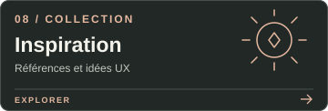
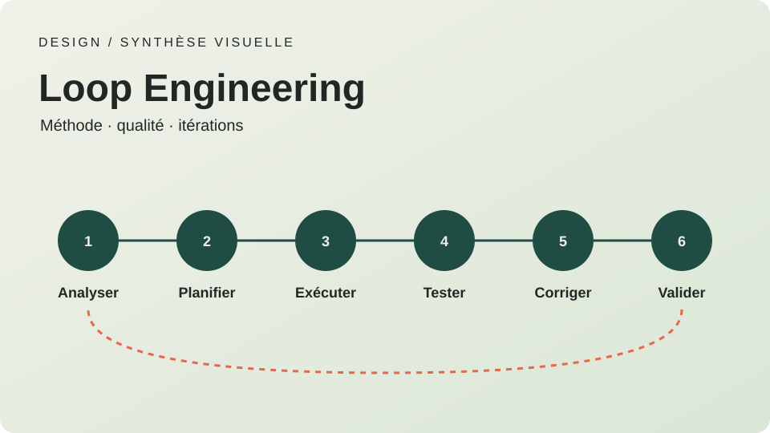

<a href="../../README.md">← Toutes les collections</a>

# Inspiration

Références et idées UX. Cette collection accueille les ressources de cette famille, chacune dans son propre dossier.

## Galerie

<!-- gallery:start -->
<table>
<tr>
<td width="50%" valign="top"><a href="loop-engineering/README.md"> <strong>Loop Engineering · Product Engineering V2</strong></a> Méthode d&#x27;ingénierie itérative, qualité produit et contrôle UX/UI anti-slop. Référence · prompt · workflow · ux · quality</td>
<td width="50%"></td>
</tr>
</table>
<!-- gallery:end -->

[Guide de classement](../../CONTRIBUTING.md)
