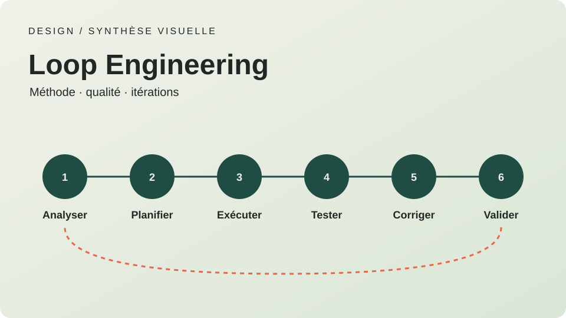

[← Collection](../README.md) · [Toutes les ressources](../../../README.md)

# Loop Engineering · Product Engineering V2

Méthode d'ingénierie itérative, qualité produit et contrôle UX/UI anti-slop.

## Ressource

- [Prompt universel](files/PROMPT.md)

Méthode transversale, pas un thème. Aperçu : diagramme original de la boucle.

## Provenance et droits

- Source : LOOP Prompt.txt (collection personnelle)
- Licence : Inconnue
- Statut : Référence ; vérifier les droits avant toute réutilisation.
