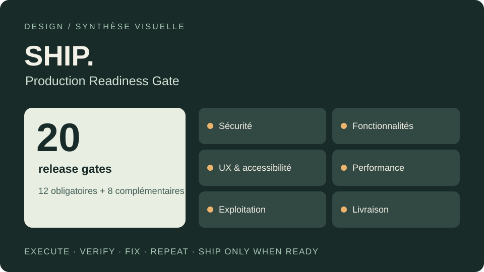

[← Collection](../README.md) · [Toutes les ressources](../../../README.md)

# SHIP · Production Readiness Gate

Master prompt de validation finale : 20 release gates, corrections itératives et décision de livraison fondée sur des preuves.

## Ressources

- [Master prompt SHIP complet](files/PROMPT.md)
- [Étape précédente : LOOP · Product Engineering V2](../loop-engineering/README.md)

## Utilisation

Après la phase de construction et d'amélioration LOOP, utiliser SHIP comme contrôle final avant livraison. Le prompt couvre 12 release gates obligatoires et 8 complémentaires, avec vérifications, remédiation, preuves et verdict final. Il ne constitue pas une autorisation de déployer en production.

Aperçu : synthèse graphique originale du contenu, et non une capture d'application.

## Provenance et droits

- Source : 02_SHIP final prompt verif.txt (collection personnelle)
- Licence : Inconnue
- Statut : Référence ; vérifier les droits avant toute réutilisation.
