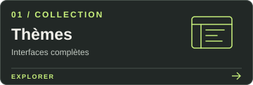
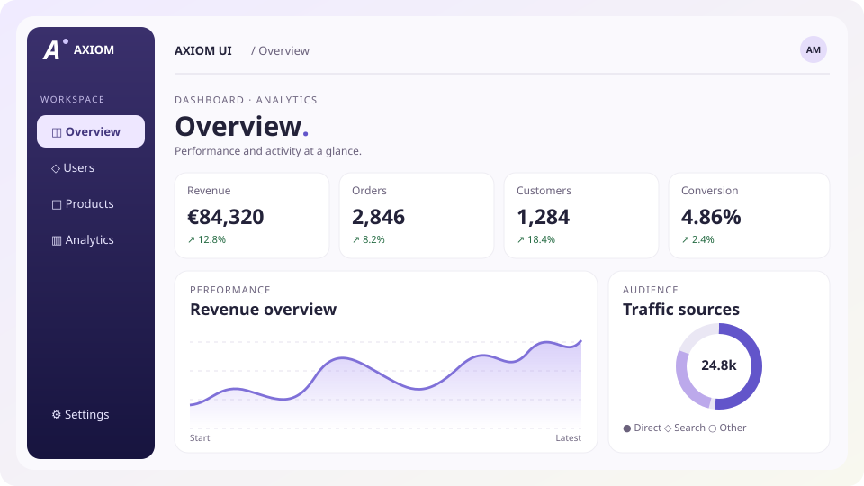

<a href="../../README.md">← Toutes les collections</a>

# Thèmes

Interfaces complètes. Cette collection accueille les ressources de cette famille, chacune dans son propre dossier.

## Galerie

<!-- gallery:start -->
<table>
<tr>
<td width="50%" valign="top"><a href="axiom-ui/README.md"> <strong>Axiom UI</strong></a> Dashboard React modulaire : KPI, graphiques accessibles, densité et navigation personnalisables. Réutilisable · react · dashboard · typescript</td>
<td width="50%"></td>
</tr>
</table>
<!-- gallery:end -->

[Guide de classement](../../CONTRIBUTING.md)
