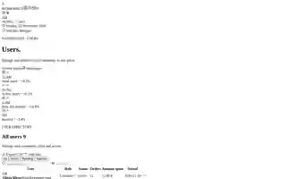

[← Collection](../README.md) · [Toutes les ressources](../../../README.md)

# Admin Dashboard V15

Dashboard React responsive avec KPI, tableaux, graphiques et paramètres personnalisables.

## Ressources

- [Guide et installation](files/README.md)
- [Aperçu HTML autonome](files/preview-users.html) (télécharger le fichier Raw, puis l’ouvrir dans un navigateur)
- [Prompt d'intégration](files/PROMPT_CODEX.md)
- [Licence MIT](files/LICENSE)

Miniature : capture réelle haute définition du prototype HTML autonome, rendu et vérifié dans Chromium sur ordinateur et mobile.

## Provenance et droits

- Source : admin-dashboard-v15-template.zip (collection personnelle)
- Licence : MIT
- Statut : Réutilisable
