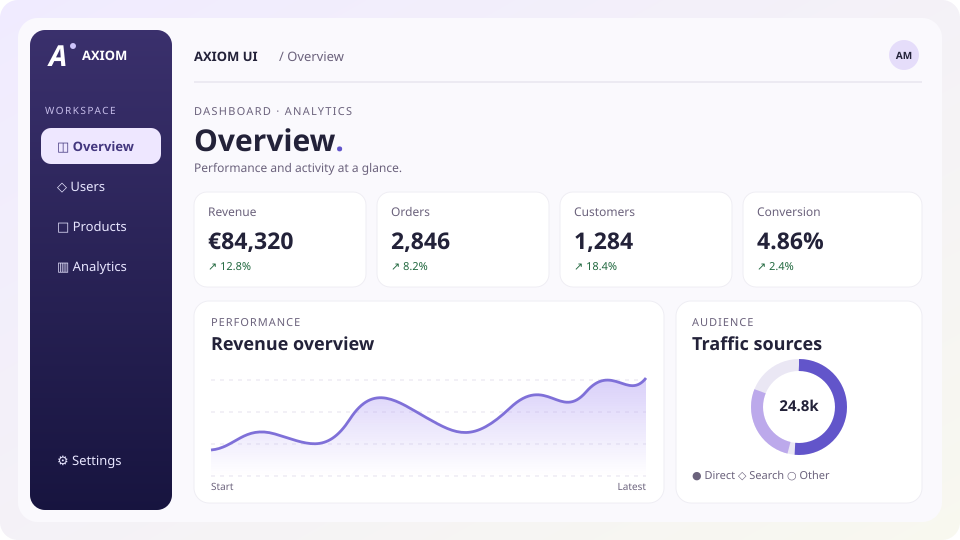

[← Collection](../README.md) · [Toutes les ressources](../../../README.md)

# Axiom UI

Dashboard React responsive avec KPI, tableaux, graphiques et paramètres personnalisables.

*Precision, in motion.*

Navigation extensible, thème clair/sombre et densité mémorisés. Les graphiques exposent aussi leurs données textuelles.

## Ressources

- [Charte UX/UI](files/DESIGN.md)

- [Guide et installation](files/README.md)
- [Aperçu HTML autonome](files/preview-users.html) (télécharger le fichier Raw, puis l’ouvrir dans un navigateur)
- [Prompt d'intégration](files/PROMPT_CODEX.md)
- [Licence MIT](files/LICENSE)

Miniature : synthèse vectorielle de la direction visuelle Axiom UI. L'[ancienne capture](files/reference-preview.webp) est conservée à titre historique ; la démo React permet les interactions.

## Provenance et droits

- Source : admin-dashboard-v15-template.zip (collection personnelle)
- Licence : MIT
- Statut : Réutilisable
